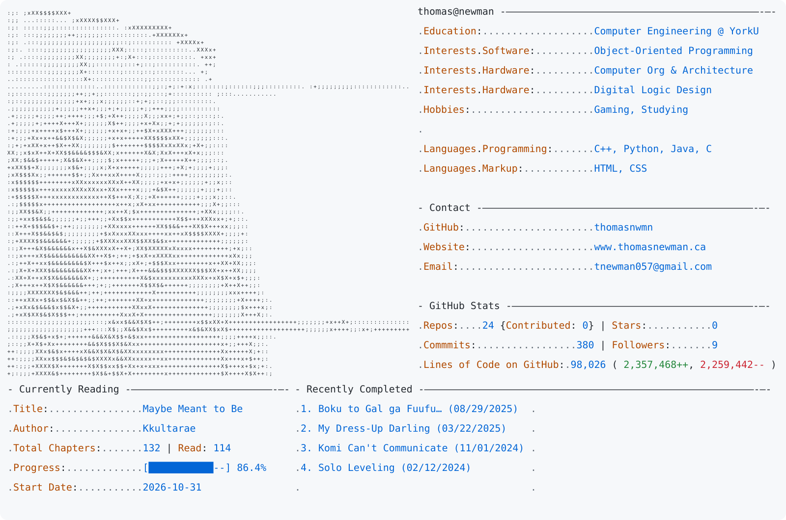

<a href="https://www.thomasnewman.ca">
  <picture>
    <source media="(prefers-color-scheme: dark)" srcset="https://raw.githubusercontent.com/thomasnwmn/thomasnwmn/main/darkmode.svg">
    
  </picture>
</a>

[Website](https://www.thomasnewman.ca) · [Email](mailto:tnewman057@gmail.com) · [Repositories](https://github.com/thomasnwmn?tab=repositories)

